# disktiles


See what is using your disk as a map of tiles, mark what should go, review the list, and move it
to the trash. An [omasharp](https://github.com/luisrudge/omasharp) app for Omarchy: C# (native
AOT) and QML, made with the `omarchy-app` template (`Omasharp.Templates` 0.1.1).

Up to 0.2.0, disktiles was a GTK 4 app for Linux, macOS and Windows (the
[v0.2.0 release](https://github.com/luisrudge/disktiles/releases/tag/v0.2.0) and the git history
before 0.3.0). Below, "the original" is that version.

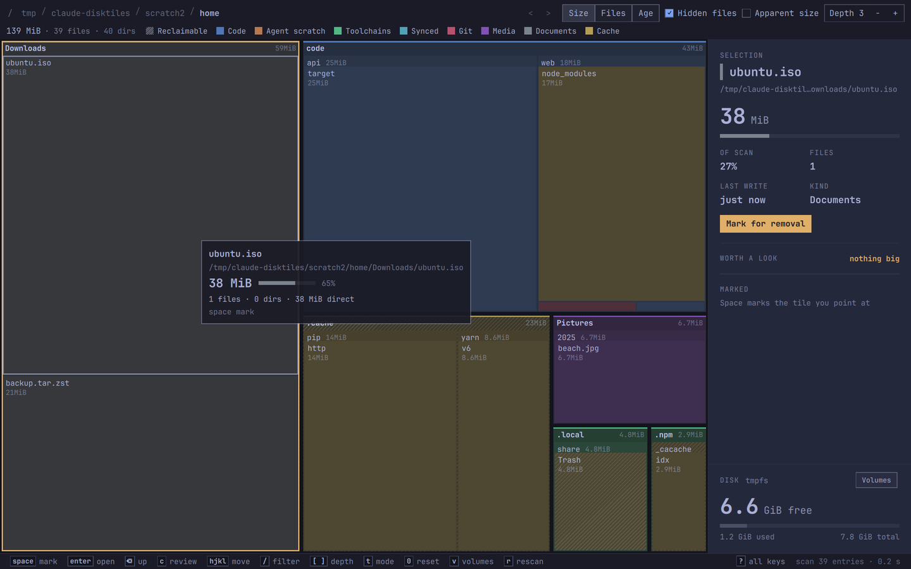

- The scan, the treemap layout, the categories, the filter, the marks and the removal guards
  are the original's core, unchanged except that the macOS and Windows code is gone.
- The treemap is drawn natively: C# builds an `Omasharp.Drawing` and the host's `DrawView` puts it
  straight into Qt's scene graph. No JSON, no JavaScript and no `Canvas`.
- It looks like an Omarchy app: the Omarchy font, the current theme's colours, and it follows
  theme switches live.
- Removal is guarded: it refuses the root, your home folder, system folders and anything with a
  mount inside it. It moves things to the trash by default, and a permanent deletion always asks
  first.

## Install

On Omarchy, for your user only (no sudo, and no .NET: it's native code on the Qt Omarchy ships):

```sh
curl -fsSL https://github.com/luisrudge/disktiles/releases/latest/download/install.sh | sh
```

Run it again to update. To remove it:

```sh
curl -fsSL https://github.com/luisrudge/disktiles/releases/latest/download/install.sh | sh -s uninstall
```

It puts DiskTiles in the app launcher, the app in `~/.local/share/omasharp/disktiles/`
and the `disktiles` command in `~/.local/bin`. The script checks the download against
the release's `SHA256SUMS`, and stops without installing anything if your system's Qt is older
than the one the release was built with (then update Omarchy and run it again). Releases are
x86_64 only. Elsewhere on Arch it needs `qt6-declarative`.

## Use

```sh
disktiles                   # your home folder
disktiles ~/projects        # a folder
disktiles --disk            # the whole disk
disktiles --help            # every option
```

Inside, `?` lists every key: arrows or `hjkl` to move, Enter to open, Backspace to go up, Space
to mark, `c` to review the marked list, `/` to filter by name.

| | |
|---|---|
| 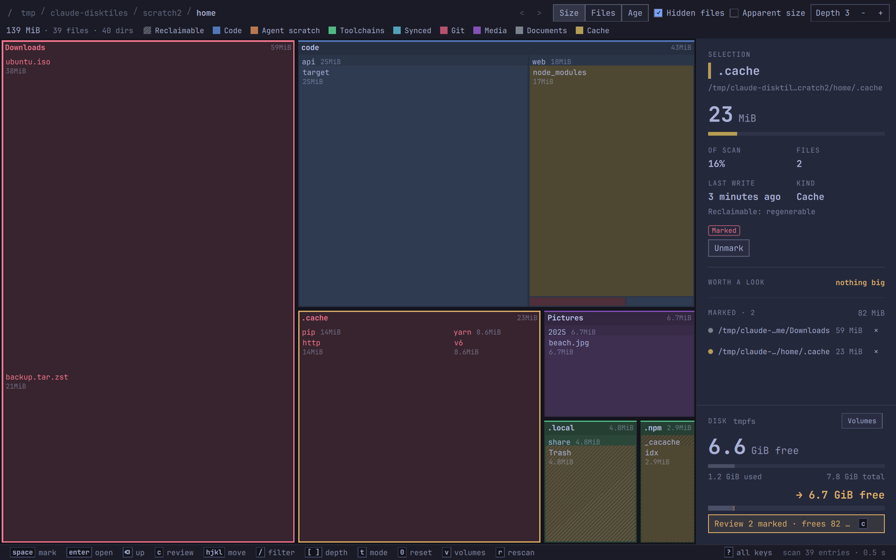 | 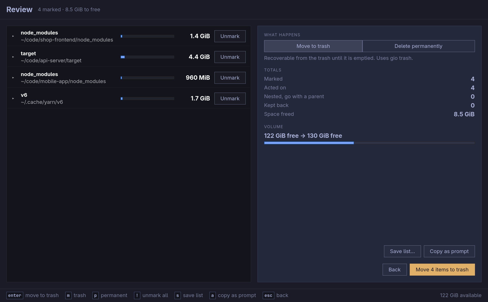 |
| 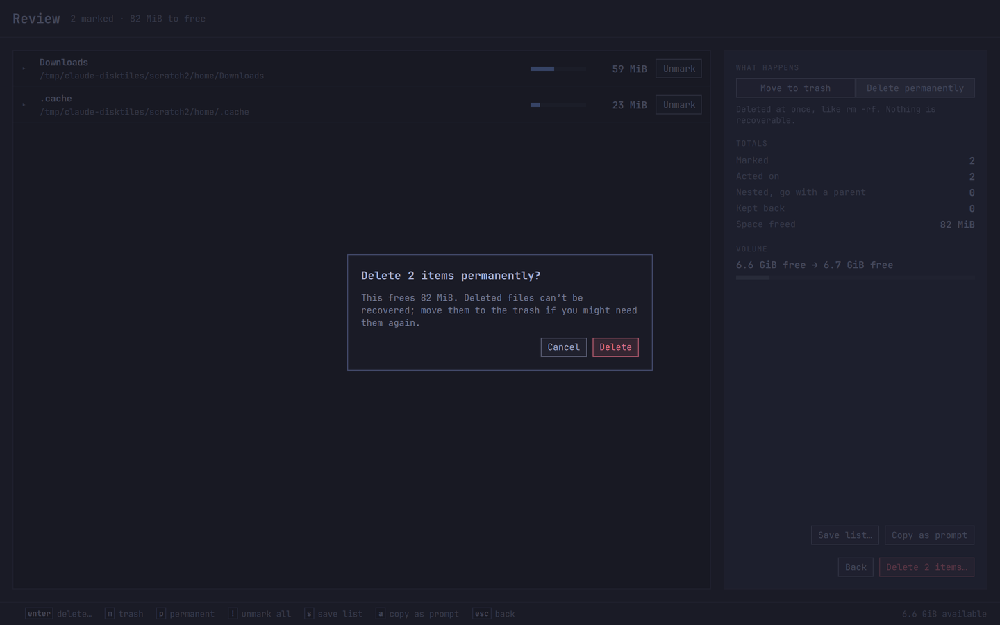 | 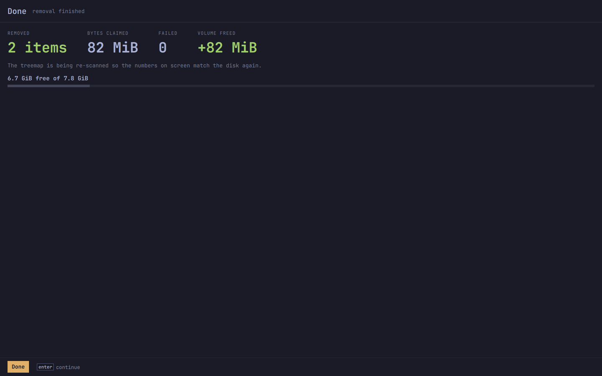 |
| 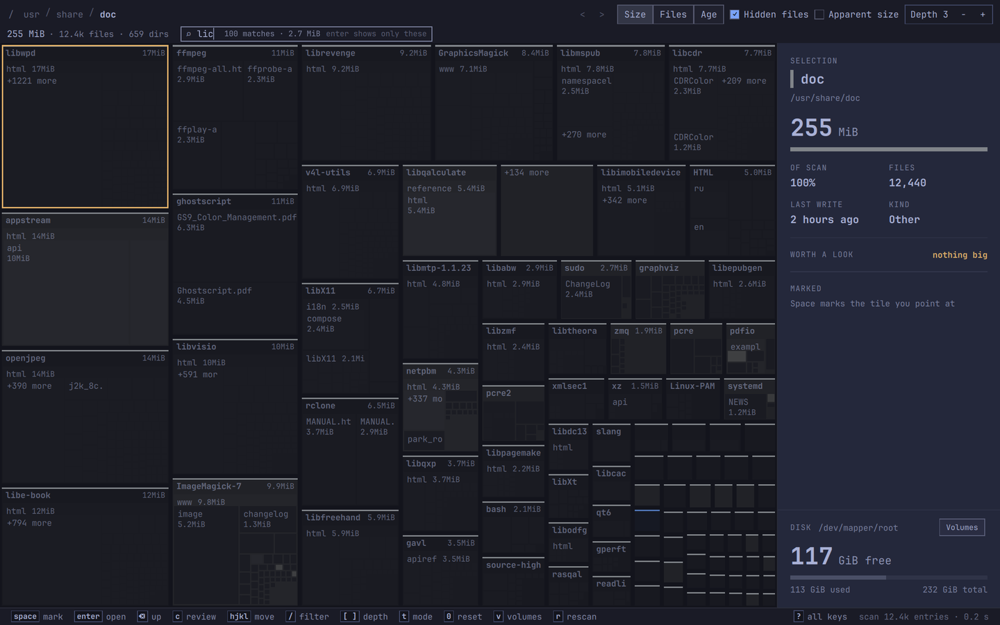 | 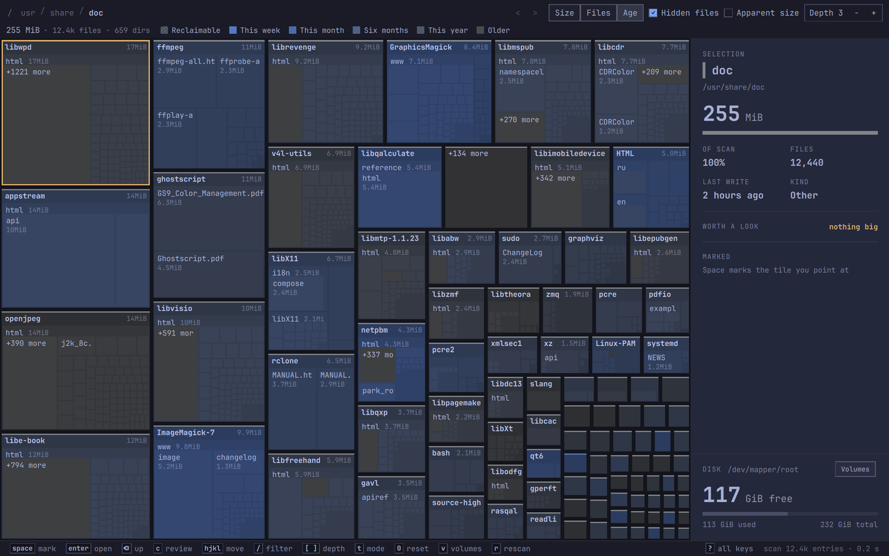 |
| 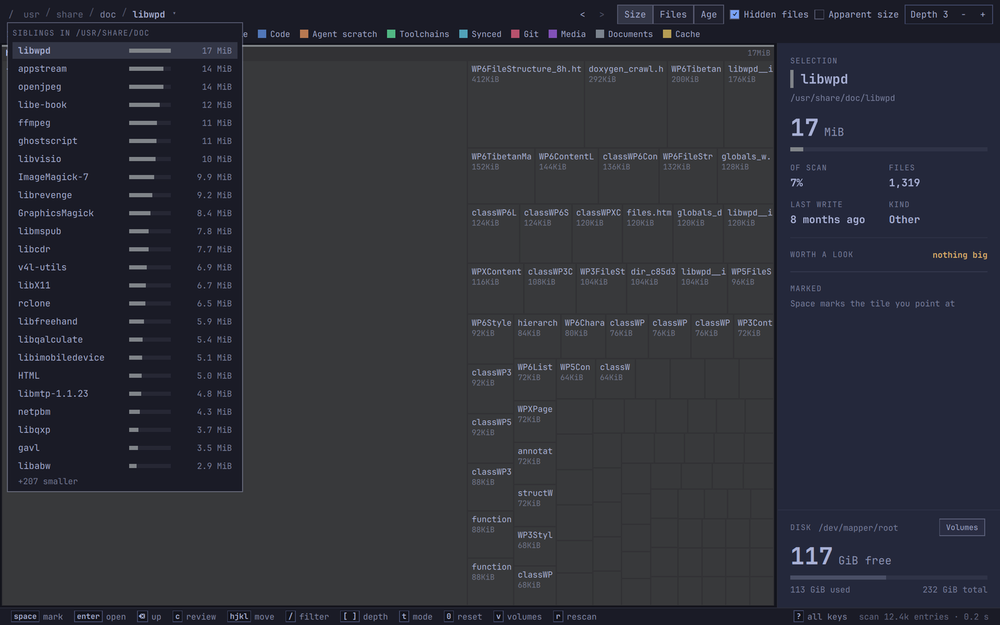 | 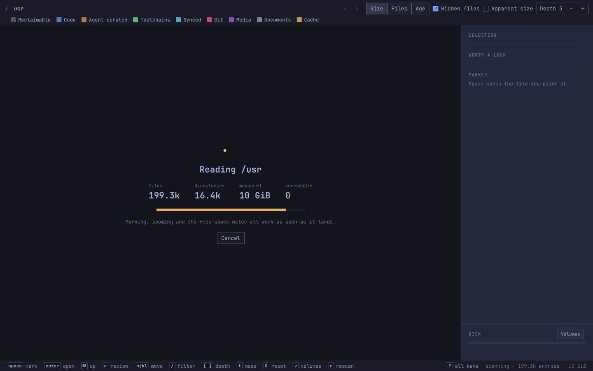 |
| 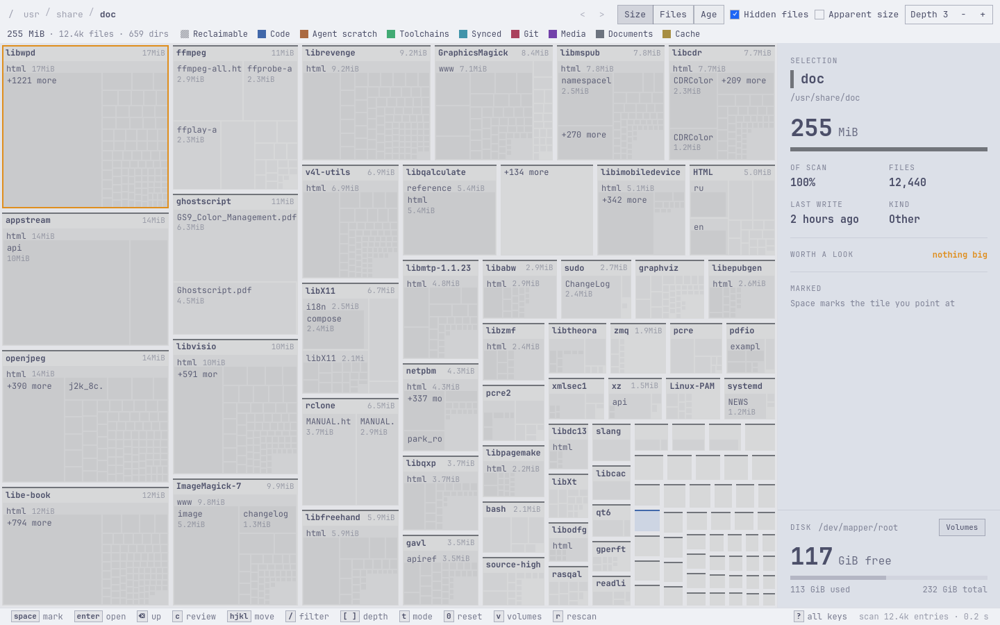 | 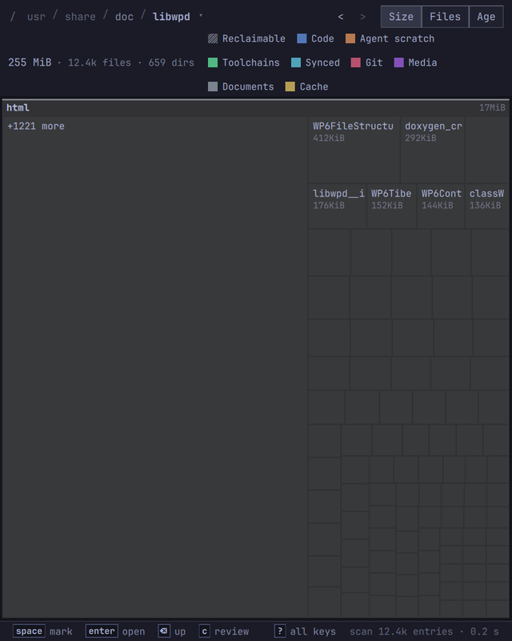 |

## Feature parity

Every feature of the original (0.2.0, `ec3b32d`) on Linux, and where it
stands here. ✅ ported and checked · ➖ there, but done differently (the note says how) ·
— not in either app.

### Scanning and the command line

| Feature | | Note |
|---|---|---|
| `PATH` (default: home; made absolute, links resolved, must be a directory) | ✅ | |
| `-a/--apparent-size`, `-l/--follow-links`, `-H/--no-hidden` | ✅ | |
| `-D/--disk` (the disk home is on; not with a `PATH`) | ✅ | |
| `-X/--cross-filesystems`; `-x/--one-filesystem` (the default) | ✅ | |
| `-d/--depth N` (1–6, default 3) | ✅ | |
| `--power-efficiency miser\|balanced\|aggressive\|drain-my-battery`, `--scan-threads N` | ✅ | |
| The saved preset in `~/.config/disktiles/power-efficiency` | ✅ | Same file as the original, so both apps share it. Read-only in both |
| `--metric files\|bytes` | ✅ | |
| `--snapshot FILE` (PNG once the scan is shown, then quit; 1 on failure) | ➖ | Qt's `grabToImage`. No "second window" check: every launch is its own window, as in the original |
| `-V/--version`, `-h/--help` | ✅ | |
| One scan at a time; a new one cancels the old; cancel never shows a partial tree | ✅ | |
| Scan overlay: spinner, "Reading …", files, directories, measured, unreadable, meter, Cancel / Scan again, errors | ✅ | |
| Footer status: scanning… / `scan 12.4k entries · 0.2 s` / cancelled / failed | ✅ | |
| `r` / `F5` / `ctrl+r` scan again, `Esc` stops a scan | ✅ | |
| `v` volume picker (point · device · free; keys and click outside) | ✅ | |
| `ctrl+o` choose a folder to scan | ✅ | Qt's folder dialog, through the desktop portal like GTK's |
| `g` the whole disk; crumbs above the root widen the scan | ✅ | |

### Modes and the treemap

| Feature | | Note |
|---|---|---|
| Size / Files / Age (`t`, header buttons) | ✅ | |
| Age: last-write colours on the accent hue, the legend becomes the ramp | ✅ | |
| `d` apparent size, `i` hidden entries (and the two check boxes) | ✅ | In a narrow window the check boxes and the depth control give way to the trail; their keys still work |
| Squarified layout, name bands, "+N more" tails | ✅ | Same core |
| Category fills lifted by depth, accent strip, legend (Reclaimable + 8 categories) | ✅ | |
| Hatch on reclaimable tiles | ✅ | |
| Labels: bold band names, sizes at the band's end, after the name or under it | ➖ | Monospace (the Omarchy font) measured with `Drawing.MonoAdvance`; the original measured Cairo's sans |
| Marked tiles: danger fill and labels, 2 px ring | ✅ | |
| Filter dimming | ✅ | |
| Hover outline, amber selection ring, hover card (name, path, size and share, counts, badges, key hint; flips to stay inside) | ✅ | |
| No repaint on hover or zoom; a sharp repaint 150 ms after the motion stops | ✅ | `DrawView`'s `view` transform |
| `[` / `]` depth 1–6, Depth − + control | ✅ | |
| `+` `-` `0` magnify, shrink, reset; "1.6×" in the footer | ✅ | |
| Wheel zoom toward the pointer, going in when a directory fills the view, out and up at 1× | ✅ | |
| Touchpad scrolling | ✅ | Pixel deltas, 24 px a notch, as the original |
| `shift`+wheel pans | ✅ | |
| Into / out of a directory: eased transition | ✅ | |

### Navigation

| Feature | | Note |
|---|---|---|
| Arrows / `hjkl` (nearest tile at the same depth; parent at the edge), `Tab` / `shift+Tab` | ✅ | |
| `Return` opens (a file opens its folder), `BackSpace`/`u` up, the `Esc` chain | ✅ | |
| Click selects, a click on the selection or a double click opens | ✅ | |
| Right click / `o` / `ctrl+R`: show it in the file manager | ➖ | `org.freedesktop.FileManager1.ShowItems` (Nautilus selects it), else `xdg-open` on the folder; the original used the portal's OpenDirectory |
| Middle click / `ctrl`+click marks without moving the selection | ✅ | |
| Back / forward: `alt+←/→`, the mouse's side buttons, `<` `>` with tooltips | ✅ | |
| Trail from `/`, folded past 7 steps, ▾ sibling menu (largest first, share bars, keys) | ✅ | |
| Totals line: bytes · files · dirs · unreadable | ✅ | "1 file", "1 dir": the original said "1 files" |
| `/` or `s` filter: dims non-matches, Enter shows only them, Esc clears, "N matches · size" | ✅ | |
| `p` panel, the panel divider (drag, double click resets), the panel hides in a narrow window | ✅ | |
| `ctrl+=` `ctrl+-` `ctrl+0` interface zoom | ✅ | Scales every QML size |
| `?` every key, on every screen | ✅ | |
| `q` / `ctrl+q` / `ctrl+w` quit | ✅ | |
| `f` frame-rate overlay (debug builds) | ➖ | fps plus the interval between presented frames; Qt renders on its own thread, so there is no per-frame CPU time to show |

### The panel and insights

| Feature | | Note |
|---|---|---|
| Selection: name, path, size, share, of scan, files, last write, kind, reclaimable reason; follows folder, selection or hover, 10/s | ✅ | |
| Git line for checkouts: changed / stashes / unpushed or "clean", one query at a time, guarded `git` | ✅ | |
| Mark button and chips (Marked, Goes with X) | ✅ | |
| Worth a look: reclaimable folders, worktrees, stale experiments; click opens it | ✅ | |
| Marked: count, total, rows with × , "+N more", nested and kept back | ✅ | |
| Disk: device, free, used bar, Volumes button | ✅ | |
| Free after the marks: "→ X free", "Review N marked · frees X… c" | ✅ | |
| Notices (neutral, success, warning, error) | ✅ | |

### Marking, review and removal

| Feature | | Note |
|---|---|---|
| `space` / `x` mark; root refused; marks inside a marked folder refused; a folder absorbs inner marks | ✅ | |
| Marks survive rescans, mode changes and widening; cleared after a removal | ✅ | |
| Review: rows, chips, share bars, Unmark; trash / permanent; totals; volume meter; kept back | ✅ | |
| Review keys: `Return` commit, `m` trash, `p` permanent, `!` unmark all, `s` save list, `a` copy as prompt, `Esc` back | ✅ | |
| Permanent deletion asks first (Delete / Cancel; `Return` / `Esc`) | ✅ | |
| Running: "N of M done", log, `Esc` stops after the current item | ✅ | |
| Done: removed, bytes claimed, failed, volume freed (measured), automatic rescan | ✅ | "1 item": the original said "1 items" |
| Guards: root, scanned root, home (and what holds it), outside the root, system trees, mount points and mounts inside, links, undecodable names; checked again at removal | ✅ | Same core, tested |
| Trash: `trash-put`, then `gio trash`, then the XDG home trash; none → permanent | ✅ | |
| Delete list (one path per line) and agent prompt export | ✅ | |
| Save list dialog | ➖ | Qt's file dialog (the portal's, like GTK's) |

### The desktop

| Feature | | Note |
|---|---|---|
| Omarchy theme: `colors.toml` roles, derived surfaces, Tokyo Night on errors, `theme.name` | ✅ | Colours from the bridge's `Theme`; the name from `current/theme.name` |
| Follows a theme switch live | ✅ | `Theme.Changed`; checked by swapping Tokyo Night for Catppuccin Latte under a scratch `HOME` |
| Off Omarchy: the system's light or dark | ✅ | Followed live here (the original read it once) |
| The pre-v4 theme folder (`~/.config/omarchy/current`) | — | Dropped: Omarchy 4 only, as the bridge reads |
| Fonts | ➖ | The Omarchy font everywhere, like Omarchy's own apps; the original used GTK's UI font for text |
| Title `disktiles · ~/folder` | ✅ | Follows the scanned root |
| 1440×900, no minimum size, every launch its own window | ✅ | |
| Footer key hints (only bound keys) + "? all keys" + status | ✅ | |
| Desktop entry: generic name, comment, `%f`, categories, keywords, "Scan the whole disk" action, icon | ✅ | `app.desktop` (the bridge fills in the binary, the icon and `StartupWMClass`) |
| Notifications | — | Neither app sends any |
| macOS and Windows | — | Linux only, by design |
| `DISKTILES_*` test switches | ➖ | `--test-*` options in debug builds (`App/Hooks.cs`), because check.sh's compositor passes no environment; `DISKTILES_LOG` and `DISKTILES_PERF`/`DISKTILES_WORKLOAD` stay variables |

## Benchmark

GTK original vs this port, both native AOT release builds, on this machine (a 2015 MacBook Pro:
i5-5257U, 2 cores / 4 threads; Omarchy, kernel 7.2.8, GTK 4.24.1, Qt 6.12.0). Raw data and the
full tables: [bench/results/](bench/results/).

**Startup and latency** (`bench/ibench.sh`, the earlier port's harness): builds with test hooks
(`-p:TestHooks=true`; the GTK one with the earlier port's instrumentation patch) log the same
`DISKTILES_PERF` events and run the same `DISKTILES_WORKLOAD` drivers. A private nested
Hyprland on a hidden special workspace, 3200×2000 at 2x, windows 1440×900. Warm cache, the two
apps alternating, 5 runs of each workload.

| `/usr/share/doc` (14.8k entries), median ms | GTK | port | earlier port (its doc) |
|---|---|---|---|
| Window shown | 115 | 170 | 170 |
| Scan done | 258 | 173 | 172 |
| **First treemap presented** | **391** | **258** | 262 (GTK then: 360) |
| CPU to the first treemap | 440 | 300 | 310 |
| Layouts / paints until then | 2 / 2 | 1 / 1 | 1 / 1 |
| First treemap, `/usr/share` (120k entries) | 482 | 358 | 366 |

| Key → frame presented, median / p95 ms | GTK | port |
|---|---|---|
| Return, into the largest folder (~100 tiles) | 58 / 81 | 13 / 26 |
| BackSpace, out to the root (~1,300 tiles) | 53 / 85 | 16 / 33 |
| `t` (Size / Files / Age) | 84 / 117 | 16 / 31 |
| `[` `]` (depth) | 52 / 83 | 12 / 24 |
| one filter key | 54 / 80 | 18 / 31 |

| 8 s workloads: CPU ms / missed vsyncs | GTK | port |
|---|---|---|
| SWEEP (hover every frame) | 2,740 / 76 | 4,120 / 0 |
| ZOOMSWEEP (wheel in and out) | 1,520 / 74 | 3,320 / 1 |
| NAV (Return, BackSpace every 400 ms) | 1,840 / 18 | 1,560 / 10 |
| MODES (`t` every 400 ms) | 1,780 / 12 | 500 / 0 |
| DEPTH (`]` `]` `]` `[` `[` `[`) | 1,140 / 0 | 410 / 0 |
| FILTER (`/license` Return Escape) | 2,120 / 66 | 1,100 / 41 |

**The window from outside** (`bench/bench.sh`, omasharp's `tools/bench.sh` made safe to run
next to other benchmarks): plain release builds, launched on a hidden special workspace of the
session, 7 alternating runs, `/usr/share/doc`.

| median (range) | GTK | port |
|---|---|---|
| Time to window | 398 ms (304–466) | 365 ms (275–571) |
| RSS / PSS | 89 / 64 MB | 117 / 60 MB |
| Threads | 19 | 20 |
| Idle CPU, wake-ups/s | 0‰, 0 | 0‰, 3 |
| Close | 42 ms | 58 ms |
| On disk | 5.05 MB (one file) | 5.31 MB (host 0.25 + lib 5.03 + QML 0.04) |

What it says:

- The port shows its first treemap about 130 ms sooner and answers keys 3–5× faster. It lays out
  and paints once where GTK does it twice, and its paint is a 4 ms C# `Drawing` against GTK's
  70 ms Cairo texture. That holds the earlier port's level (262 ms; 13–20 ms per key).
- Its frames are steadier: Qt renders on its own thread, so hover and zoom miss 0–1 vsyncs in
  8 s where GTK misses about 75.
- It costs more CPU while frames animate nonstop (hover and zoom sweeps): Qt redraws the whole
  window every frame, where GTK repaints only what changed. For keys and modes it uses less.
- Its window appears about 55 ms later inside the process (the QML engine), but its scan starts
  earlier, so the treemap still wins.
- More RSS (Qt's shared libraries), less PSS. The 3 idle wake-ups a second are Qt's Wayland
  event threads: a plain Qt C++ app (`/usr/bin/omacalc`) has the same 3.
- A first pass ran while other work loaded the machine (load average up to 6 on 4 threads):
  everything was slower for both apps, by about the same amount. The tables are from a second,
  quiet pass (load average median 1.05, logged in `loadavg.txt`).

To run it again: build the four binaries (GTK from luisrudge/disktiles with the .NET 11 SDK:
`dotnet publish src/Disktiles -c Release`, and with `-p:TestHooks=true` plus
`orig-instrumentation.patch` from the earlier port's docs; this app with `dotnet publish -o
/tmp/claude-disktiles/port-plain` and `-p:TestHooks=true -o /tmp/claude-disktiles/port-perf`),
then `sh bench/run-all.sh /tmp/claude-disktiles/bench` (about 20 minutes; it never shows
anything on screen).

## Build and check

You need the .NET SDK 10; qmake6 and g++ ship with Omarchy. The checks never show anything on
your screen: they run the app in a private, invisible compositor.

```sh
dotnet run --project tests                                                    # core, removal (scratch trees only), the controller
sh .agents/skills/omasharp/scripts/check.sh --size 1600x1000 --args "/usr/share/doc"            # tests, dev build, screenshot
sh .agents/skills/omasharp/scripts/check.sh --release --size 1600x1000 --args "/usr/share/doc"  # the native AOT build
```

The build treats warnings as errors and runs .NET's recommended analyzers and omasharp's
(`OMASHARP0xx`). The two exceptions, with their reasons, are in `.editorconfig`.

How it's organized: `Core/` (no UI), `App/` (the controller as view models, no Qt),
`Backend.cs` (what QML sees), `Main.qml` and `ui/` (rendering only). More in `AGENTS.md`.

Install your own build the way the script does (the same files, from the same `install.sh`):
`dotnet publish -t:Install`, and `dotnet build -t:Uninstall` to remove it.

**Releasing:** set `<Version>` in `DiskTiles.csproj`, then push a tag that matches it
(`git tag v0.3.0 && git push origin v0.3.0`). `.github/workflows/release.yml` tests the app,
builds it on Omarchy's stable packages (so every up-to-date Omarchy can run it), and attaches
`dotnet publish -t:Package`'s files to a GitHub release: `disktiles-linux-x64.tar.gz`,
`SHA256SUMS` and `install.sh`.

What the template, bridge, skill and analyzers got wrong or lacked, with fixes:
[FEEDBACK.md](FEEDBACK.md).

## Credits

disktiles is by Luis Rudge, and started as a C# port of [disktree](https://github.com/tobi/disktree).
This version reuses the original's core and an earlier experimental QML port. MIT licensed
([LICENSE](LICENSE)), like disktree.
