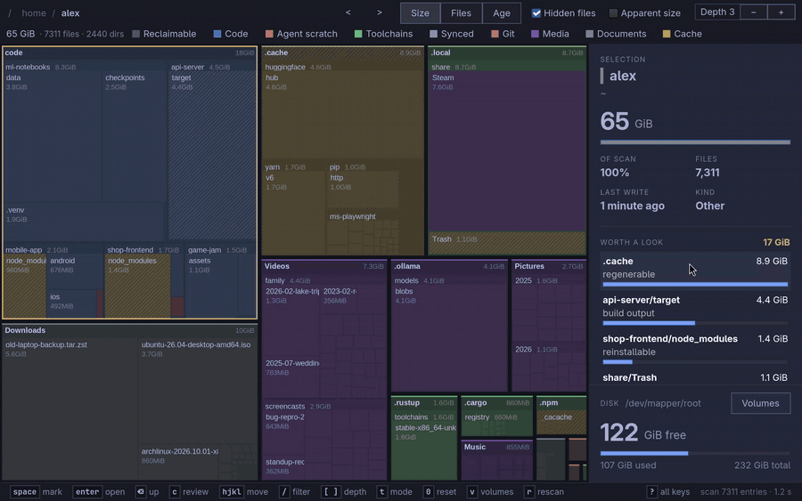
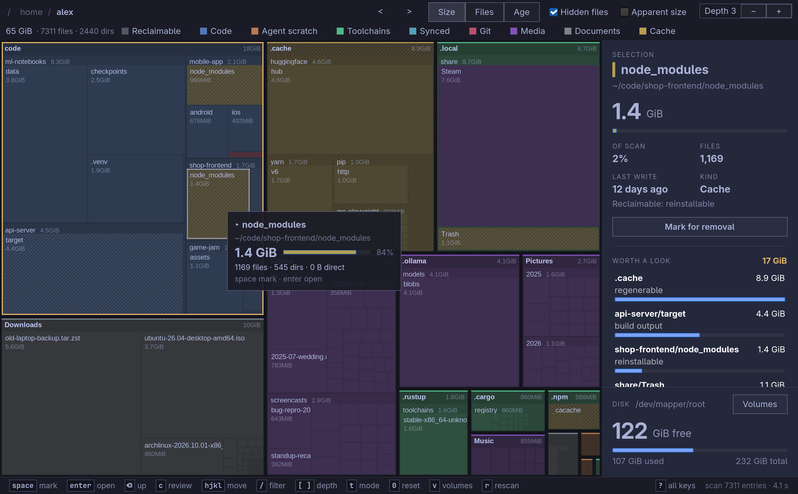
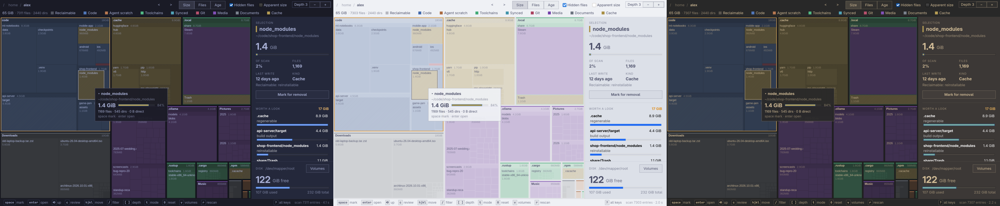
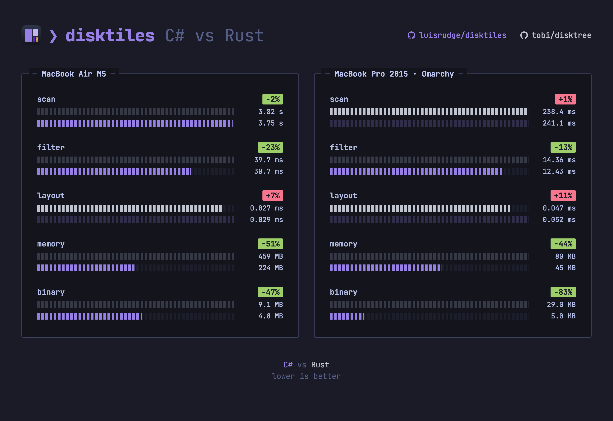

# disktiles


See what is using your disk as a map of tiles, each sized by what it holds.
Mark what should go, review the list, and move it to the trash. Built for
[Omarchy](https://omarchy.org): it follows your Omarchy theme and fits in with
Hyprland. It runs on any Linux with GTK 4, on macOS and on Windows.

- One native executable, about 5 MB. It uses the GTK 4 already on your system.
- Scans 250k files in about a second on an old dual-core laptop.
- Shows which folders are worth a look first (`node_modules`, caches,
  build output), which ones git tracks, and how much free space you'd have
  after removing what you marked.
- Removal is guarded: it refuses the root, your home folder, system folders
  and anything with a mount inside it. It moves to the trash by default, and a
  permanent deletion always asks first.



## Install

### Linux and macOS

```sh
curl -fsSL https://github.com/luisrudge/disktiles/releases/latest/download/install.sh | sh
```

It needs no sudo. To remove it again:

```sh
curl -fsSL https://github.com/luisrudge/disktiles/releases/latest/download/install.sh | sh -s uninstall
```

- **Linux** (x64, arm64): `disktiles` goes into `~/.local/bin`, with a launcher
  entry and an icon under `~/.local/share`. It needs GTK 4, which Omarchy
  already has. Elsewhere, install `gtk4` (Arch) or `libgtk-4-1` (Debian,
  Ubuntu).
- **macOS** (Apple silicon): `disktiles.app` goes into `~/Applications`, and the
  `disktiles` command into `~/.local/bin`. It needs GTK 4 from Homebrew:
  `brew install gtk4`.

### Windows

In PowerShell:

```powershell
irm https://github.com/luisrudge/disktiles/releases/latest/download/install.ps1 | iex
```

It needs no admin, and brings its own GTK. disktiles goes into
`%LOCALAPPDATA%\Programs\disktiles`, with a Start menu entry and the
`disktiles` command on your `PATH`. On ARM64, the x64 build runs under
emulation. To remove it again:

```powershell
& ([scriptblock]::Create((irm https://github.com/luisrudge/disktiles/releases/latest/download/install.ps1))) uninstall
```

On Windows, sizes are file sizes (not the space on disk) and hardlinks are
counted once per name. Removal uses the Recycle Bin, and refuses Windows' own
folders, other profiles, junctions and cloud placeholders (OneDrive), which you
remove in Explorer.

### Downloading by hand

Each [release](https://github.com/luisrudge/disktiles/releases) has
`disktiles-linux-x64.tar.gz`, `disktiles-linux-arm64.tar.gz`,
`disktiles-osx-arm64.tar.gz` and `disktiles-win-x64.zip`; each holds the install
script, which installs from its own folder. The install scripts check every
download against the release's `SHA256SUMS`. To check that a file was built by
this repository's release workflow, from its tagged source:

```sh
gh attestation verify disktiles-linux-x64.tar.gz --repo luisrudge/disktiles
```

The builds are not signed yet. Downloaded in a browser, macOS stops the app the
first time: open it from Finder with right-click, Open. Windows SmartScreen may
warn too: More info, Run anyway. The install scripts avoid both, but with
Smart App Control on, Windows runs no unsigned app.

## Use

Open **disktiles** from the app launcher, or run it from a terminal:

```sh
disktiles              # your home folder
disktiles ~/projects   # a folder
disktiles --disk       # the whole disk
disktiles --help       # every option
```

Inside, `?` lists every key: arrows or `hjkl` to move, Enter to open, Backspace
to go up, Space to mark, `c` to review the marked list, `/` to filter by name.




It follows the current Omarchy theme, and switches with it live. Here in Tokyo
Night, Catppuccin Latte and Gruvbox:



## Performance

disktiles started as a C# port of [disktree](https://github.com/tobi/disktree),
so the two scan engines can be measured side by side: the same operations,
headless, medians of 3 rounds, each machine scanning its own folder. Binary
is the size of each project's release executable.



## Build from source

You need the .NET 11 SDK (the version is pinned in `global.json`) and GTK 4.

```sh
dotnet publish src/Disktiles -c Release -o out   # out/disktiles
DISKTILES_FROM=out sh packaging/install.sh       # install that build (Linux)
dotnet run --project tests/FilterTests
dotnet run --project tests/RemovalTests          # fixtures in the temp folder only
```

The build runs .NET's recommended analyzers and fails on any warning.
Formatting is .NET's default: `dotnet format disktiles.slnx` fixes it, a
pre-commit hook checks the files you commit (turn it on once with
`git config core.hooksPath .githooks`), and CI checks everything.

GTK 4 for building and running comes from your package manager, Homebrew on
macOS (`brew install gtk4`), or [MSYS2](https://www.msys2.org) on Windows
(`pacman -S mingw-w64-ucrt-x86_64-gtk4`, with `C:\msys64\ucrt64\bin` on your
`PATH`). The packages a release ships are made by `packaging/macos-bundle.sh`
(`disktiles.app`) and `packaging/windows-bundle.sh` (the exe with GTK beside
it); [release.yml](.github/workflows/release.yml) shows how.

How the code is organized: [docs/ARCHITECTURE.md](docs/ARCHITECTURE.md).
Omarchy and Hyprland specifics: [docs/OMARCHY.md](docs/OMARCHY.md).

## Credits

disktiles started as a C# port of [disktree](https://github.com/tobi/disktree).
The scan, the treemap layout, the categories and the removal guards follow
its design. MIT licensed, as disktree is: [LICENSE](LICENSE).
